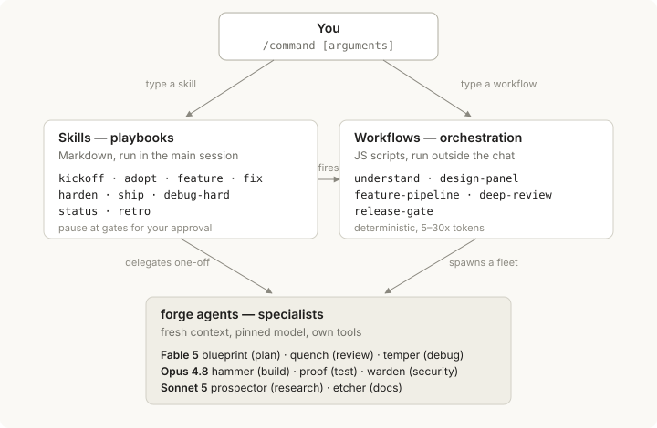

# Command guide

`AGENTS.md` lists what each command does. This page says where each kind runs and what it
costs. The behaviour itself is in the files named below.

## Three building blocks

| | Where it runs | Keeps your context? | Cost |
|---|---|---|---|
| **Skill** `skills/<name>/SKILL.md` | In your session; the agent follows the playbook and pauses at its gates | Yes | about one session |
| **Agent** `agents/forge-*.md` | Delegated to by skills; own prompt, tools and model | No — sees only its brief | one turn each |
| **Workflow** `workflows/<name>.js` | Outside the chat: Claude's Workflow tool, or `bin/forge-run.mjs` on any host | No | 5–30x |

An agent's empty context is the point: `forge-quench` judges a diff without the builder's
reasoning, so it does not share the builder's blind spots. A workflow decides in code which
agents run, on which model and effort, and how results combine — so it is reproducible.

## When to use what

**One feature → `/forge:feature`. New ideas → `/forge:next`. An already-spec'd backlog →
`/forge:build`.** `/forge:feature-pipeline` is the engine the others drive; you rarely call it.

| Situation | Command |
|---|---|
| New product idea | `/forge:kickoff <idea>` |
| Existing repo to bring in | `/forge:adopt <path>` |
| Next version of a product | `/forge:next <ideas>` |
| One feature | `/forge:feature F3` |
| Whole backlog, hands-off | `/forge:build` |
| A bug · a bug that survived two attempts | `/forge:fix` · `/forge:debug-hard` |
| Review manual work before shipping | `/forge:deep-review` |
| Before first public deploy | `/forge:harden` |
| Release | `/forge:ship v0.2.0` |
| Understand a large codebase | `/forge:understand [question]` |
| Hard architecture decision | `/forge:design-panel <brief>` |
| Session end · a run died mid-way | `/forge:status` · `/forge:resume` |
| After a milestone | `/forge:retro` |

## Rules of thumb

1. **Triggering.** Skills with `disable-model-invocation: true` in their frontmatter run only
   when you type them — their consequences are yours. The agent may start the others itself.
2. **Cost.** Workflows launch agent fleets, so they sit at gates and at real breadth, never at
   a 20-line change. Unsure → one rung lower on the ladder in `ORCHESTRATION.md`.
3. **You stay product owner.** Playbooks pause where taste or scope is decided. Building,
   testing and collecting evidence run without you.

Start your agent inside your product (`claude`, `codex` or `opencode`). Command syntax per
host: `HOSTS.md`. Workflows need the product as their `dir` arg; they do not follow your `cd`.
